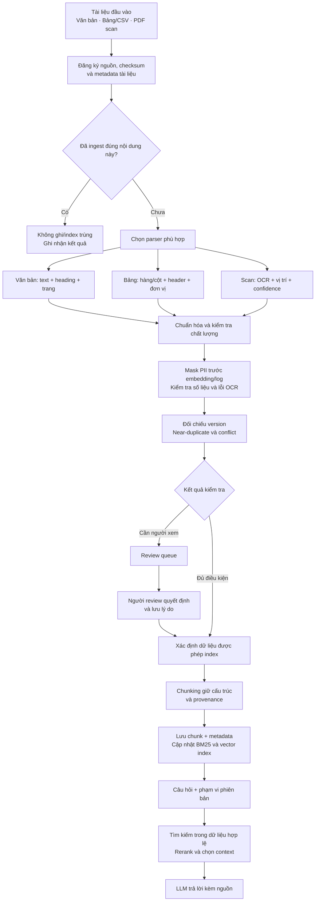

# Workflow tuần 2 — Ingestion and Data Quality

[Phân công](../src/rag/PHAN-CONG.md) · [Yêu cầu tuần 2](../../../weeks/week-02/README.md)

Tài liệu này mô tả **luồng mục tiêu của tuần 2**: từ tài liệu thô đến dữ liệu có thể dùng để tìm kiếm và trả lời, có kiểm soát chất lượng, phiên bản và nguồn chứng cứ.

Đây là hướng dẫn thiết kế để cả nhóm hiểu các điểm nối trong pipeline, không phải xác nhận mọi chức năng đã được triển khai. Code hiện tại đã có ingestion, chunking, lưu chunk, BM25/vector retrieval và hỏi đáp. Các bước kiểm soát chất lượng tuần 2 cần được bổ sung và kiểm chứng. Một số mô tả trạng thái trong `workflow.md` cũ chưa phản ánh code hiện tại.

## 1. Sơ đồ tổng thể



Đây là thứ tự logic đề xuất. Khi triển khai, một số kiểm tra có thể chạy ở cả cấp tài liệu và cấp chunk. Exact dedup có thể kiểm tra sớm bằng checksum file và kiểm tra lại bằng nội dung chuẩn hóa sau parsing. Cần giữ các điều kiện sau:

- PII được mask trước embedding và trước khi ghi nội dung vào log; nếu gọi dịch vụ LLM để bổ sung context thì dùng dữ liệu đã mask.
- Dữ liệu cần review có chính sách rõ ràng về việc được index hoặc được dùng để trả lời hay không.
- Phiên bản cũ không lọt vào truy vấn bản hiện hành.
- Mọi chunk và kết quả kiểm tra đều truy ngược được về nguồn.

## 2. Chuẩn bị dữ liệu kiểm thử

Nhóm 2 chuẩn bị 25 tài liệu nhỏ có lỗi cài sẵn và `labels.jsonl`. Các lỗi gồm duplicate, near-duplicate, conflict, phiên bản cũ/mới, khác đơn vị, OCR kém và PII giả lập.

Nhãn chuẩn là dữ liệu dùng để đánh giá detector, không được đưa vào detector như đáp án. Theo phân công, người tạo fixtures không viết detector PII/validation.

Inventory cần khảo sát các loại dữ liệu trong yêu cầu tuần 2 và giải thích cách biểu diễn, dù pipeline chỉ bắt buộc hoàn chỉnh ba nhóm: văn bản, bảng/CSV và một nhóm khó. Nhóm chọn OCR/PDF scan làm nhóm khó.

## 3. Đọc tài liệu theo loại

| Loại | Cách xử lý | Thông tin cần giữ |
|---|---|---|
| PDF text, TXT, Markdown, HTML | Trích text và nhận diện cấu trúc | Nội dung, heading, trang, nguồn |
| Bảng/CSV/XLSX | Đọc theo hàng và cột | Header, giá trị, đơn vị, kỳ, chú thích, vị trí bảng |
| PDF scan | OCR các trang cần xử lý | Text, vị trí block, confidence, liên kết ảnh/trang gốc |

PDF có thể chứa cả trang text và trang scan; cần xác định nhu cầu OCR theo từng trang. Confidence thấp phải được ghi nhận để review, không âm thầm coi nội dung OCR là chính xác.

Ví dụ: giá trị `1.500` trong bảng phải đi cùng header “Doanh thu”, đơn vị “triệu đồng” và kỳ “2025”. Tách riêng giá trị sẽ làm mất ý nghĩa.

Theo phân công, Tùng phụ trách OCR; Nhóm 2 phụ trách bảng; Nhóm 1 nối các đầu ra vào pipeline chung.

## 4. Schema và provenance chung

Schema là hợp đồng trao đổi dữ liệu giữa các module.

| Tầng | Ý nghĩa |
|---|---|
| Tài liệu | Tài liệu gì, nguồn nào, ngày hiệu lực nào, phiên bản nào |
| Page/Block/Table | Nội dung nằm ở trang, vùng hoặc bảng nào |
| Chunk | Đơn vị tìm kiếm, có liên kết về vị trí và tài liệu gốc |

Metadata cần bao phủ document/chunk ID, checksum, nguồn, heading, trang/slide/table, loại dữ liệu, ngôn ngữ, ngày thu thập/xuất bản/hiệu lực, version và quality status.

**Phân biệt định danh nội dung và quan hệ phiên bản:** code hiện tại tạo `doc_id` bằng hash nội dung. Nội dung thay đổi sẽ tạo ID khác. Để biết hai bản thuộc cùng một tài liệu logic, cần bổ sung định danh ổn định hoặc quan hệ liên kết các phiên bản; checksum riêng lẻ chưa giải quyết được việc này. Tên trường cụ thể cần được nhóm thống nhất khi thiết kế schema.

Phải phân biệt nội dung nguồn với mô tả do LLM sinh. Nếu dùng contextual enrichment, lưu context riêng với text nguồn. Biểu đồ phải giữ ảnh gốc; số liệu dùng tính toán phải được xác minh.

## 5. Kiểm soát chất lượng

| Kiểm tra | Ví dụ | Hành động |
|---|---|---|
| PII | Email, số điện thoại giả lập | Mask trong dữ liệu đưa đi embedding và log |
| OCR | Nhầm `0` thành `O`, thiếu dòng | Ghi cảnh báo, đưa vào review khi cần |
| Số liệu | Khác đơn vị, sai kiểu, tổng không khớp | Chuẩn hóa, kiểm tra và ghi kết quả |
| Exact duplicate | Upload lại đúng nội dung đã ingest | Không thêm chunk/index trùng |
| Near-duplicate | Hai bản gần giống nhưng khác một đoạn | Giữ khác biệt quan trọng và đưa trường hợp nghi vấn vào review |
| Conflict | Cùng chỉ tiêu, kỳ và phạm vi nhưng khác giá trị | Lưu mâu thuẫn kèm nguồn chứng cứ |

Chuẩn hóa số phải xét định dạng, đơn vị và kỳ. Ví dụ, `1 tỷ đồng` và `1.000 triệu đồng` có thể tương đương sau chuẩn hóa. Không nên báo conflict chỉ vì chuỗi biểu diễn khác nhau.

Tổng số học khớp không chứng minh nguồn đúng. Phát hiện conflict cũng không tự xác định được nguồn nào đúng: khác biệt có thể đến từ thời điểm hiệu lực, đơn vị hoặc lỗi nguồn.

## 6. Versioning và review queue

### 6.1. Cập nhật phiên bản

Ví dụ giả lập:

```text
Quy định A — v1: hiệu lực từ 01/01, mức phí 100
Quy định A — v2: hiệu lực từ 01/07, mức phí 120
```

Khi ingest v2, pipeline cần:

1. Nhận ra v2 thuộc cùng tài liệu logic với v1.
2. Kiểm tra ngày hiệu lực và quan hệ thay thế.
3. Lưu v2, giữ v1 để tra cứu lịch sử.
4. Cập nhật phạm vi sử dụng của từng phiên bản.
5. Đồng bộ metadata/index để truy vấn hiện hành không lấy chunk đã bị thay thế.

Không mặc định bản upload sau là bản hiện hành. Ngày thu thập khác ngày hiệu lực; bản mới có thể chưa có hiệu lực.

Nếu chỉ sửa một điều, cần xác định phần bị thay thế và phần vẫn còn hiệu lực. Không đánh dấu toàn bộ nội dung cũ hết hiệu lực nếu tài liệu chỉ được sửa một phần.

### 6.2. Review queue

Queue chứa các trường hợp cần người xem: near-duplicate đáng ngờ, conflict, OCR kém hoặc quan hệ phiên bản chưa rõ.

Một mục review nên có:

```text
Loại vấn đề: conflict
Nguồn A: mức phí 100
Nguồn B: mức phí 120
Vị trí: trang/điều/bảng tương ứng
Lý do bị đánh dấu: ...
Trạng thái xử lý: ...
Quyết định, người review và lý do: ...
```

Quyết định review phải được lưu bền vững. Không tự xóa tài liệu gần giống có khác biệt quan trọng. Không tự đưa dữ liệu đang chờ xử lý vào câu trả lời khi chưa có chính sách cho phép.

## 7. Chunking, lưu trữ và index

Chunking phải giữ ý nghĩa và nguồn:

- Văn bản: theo heading, đoạn, điều/khoản khi phù hợp.
- Bảng: giữ header, đơn vị, chú thích với phần dữ liệu tương ứng.
- OCR: giữ liên kết về trang/block gốc.
- Nếu xử lý flowchart: giữ thứ tự và điều kiện của luồng.

Tuần 2 so sánh hai chiến lược:

| Chiến lược | Cách làm |
|---|---|
| Fixed-size | Cắt theo giới hạn kích thước cố định |
| Structural | Ưu tiên ranh giới cấu trúc, có giới hạn kích thước |

Chạy trên cùng nguồn và cùng bộ câu hỏi, giữ các cấu hình khác nhất quán để đánh giá ảnh hưởng đến retrieval. Khi đổi cách chunking, dùng index/config riêng để tránh trộn kết quả.

Sau chunking:

```text
Chunk + metadata
    → lưu nội dung và provenance
    → BM25 index: tìm theo từ khóa
    → embedding + vector index: tìm theo ý nghĩa
```

Lưu trữ và index phải nhất quán khi ingest lại, cập nhật phiên bản hoặc chạy lại sau lỗi. Chỉ thêm trường version vào chunk chưa bảo đảm retrieval đã lọc đúng phiên bản.

## 8. Luồng hỏi đáp

```text
Câu hỏi + yêu cầu hiện hành/lịch sử
    → xác định phạm vi dữ liệu hợp lệ
    → BM25 + vector search trong phạm vi phù hợp
    → hợp nhất kết quả
    → rerank
    → chọn context
    → LLM trả lời
    → trích dẫn nguồn, vị trí và phiên bản
```

| Câu hỏi | Phạm vi dữ liệu |
|---|---|
| “Mức phí hiện hành là bao nhiêu?” | Phần đang có hiệu lực |
| “Mức phí tại thời điểm tháng 3 là bao nhiêu?” | Phiên bản có hiệu lực tại thời điểm đó |
| “Mức phí thay đổi thế nào?” | Nhiều phiên bản, phân biệt rõ thời gian và nguồn |

Bộ lọc phiên bản cần áp dụng đủ sớm trong retrieval. Nếu tìm trên tất cả bản rồi chỉ loại bản cũ ở cuối, các bản cũ có thể chiếm hết kết quả đầu và làm mất bằng chứng hiện hành. Nếu backend chưa hỗ trợ lọc trực tiếp, cần cơ chế tìm ứng viên và lọc bảo đảm không mất kết quả hợp lệ.

Khi không có context, code hiện tại trả lời từ chối và không gọi LLM.

Agent multi-hop của Tùng là phần pilot theo phân công, không nằm trên đường ingest bắt buộc. Ở bước hỏi đáp, agent có thể phân rã câu hỏi, retrieve, kiểm tra đủ bằng chứng và retrieve tiếp, có giới hạn vòng lặp và ngân sách.

## 9. Đánh giá và demo cuối tuần

Đối chiếu kết quả detector với nhãn fixtures:

- **TP:** có lỗi và phát hiện đúng.
- **FN:** có lỗi nhưng bỏ sót.
- **FP:** không có lỗi nhưng báo nhầm.

Cần thống nhất đơn vị đếm của từng loại lỗi, ví dụ theo tài liệu, cặp tài liệu hoặc trường dữ liệu. Báo cáo ghi rõ cách đếm, cấu hình và đường dẫn kết quả để chạy lại được.

Chuỗi demo:

```text
Ingest bản đầu
    → hỏi và kiểm tra nguồn
    → ingest lại, số chunk/index không tăng
    → ingest bản cập nhật
    → hỏi hiện hành không lẫn bản cũ
    → hỏi lịch sử vẫn lấy được bản cũ
    → ingest trường hợp mâu thuẫn
    → xem, xử lý review queue và kiểm tra kết quả
```

Đầu ra nghiệm thu gồm inventory, pipeline hoàn chỉnh ba nhóm, quality report TP/FN/FP, so sánh chunking, ít nhất 5 failure cases, README chạy lại và 5–10 slides. Mọi số trong báo cáo phải có kết quả tương ứng tại `evals/team-4.2/results/w02-*`. Dữ liệu tuần 2 dùng `DATA_DIR` riêng, không ghi đè snapshot 6 Bộ luật.

## 10. Phối hợp theo phân công hiện tại

| Bên phụ trách | Vai trò trong pipeline |
|---|---|
| Tùng | OCR engine/interface, benchmark OCR, pilot agent multi-hop, báo cáo phần OCR/agent |
| Huy + Khánh | Schema, văn bản, ingest lặp, tích hợp OCR, versioning, near-dup/conflict/review, chunking, demo và báo cáo chính |
| Tuấn + Tú | Fixtures/nhãn, inventory, câu hỏi, parser bảng, PII, validation, quality evaluation và các đầu ra được giao |

Các mốc bàn giao trong `PHAN-CONG.md`:

| Thời điểm | Bàn giao |
|---|---|
| Sáng ngày 1 | Nhóm 1 gửi PR nháp schema `DocMeta`/`Chunk` |
| 17h ngày 1 | Nhóm 2 giao fixtures và nhãn đã commit |
| Cuối ngày 2 | Tùng giao `OCREngine` và `TesseractEngine` chạy được |
| Trước ngày 3 | Nhóm 2 giao hàm chuẩn hóa/so sánh số cho conflict detection |
| Trước ngày 4 | Nhóm 2 giao benchmark đã tách dev/test cho Tùng |
| Ngày 4 | Tùng và Nhóm 2 gửi mục báo cáo cùng failure cases cho Nhóm 1 |

Lưu ý: task validation trong bảng phân công ghi ngày 3, nhưng API lại phải bàn giao trước ngày 3. Nhóm cần thống nhất mốc bản tối thiểu để không chặn conflict detection.
