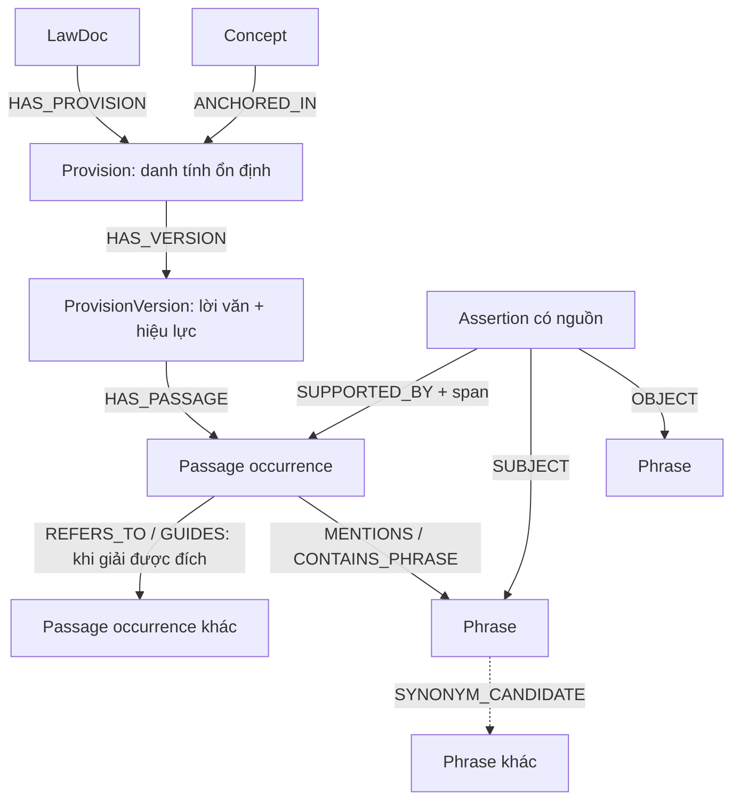

# Unified Legal Graph — thiết kế chốt cho thử nghiệm

Ngày: 2026-11-17. Trạng thái: thiết kế để triển khai và đánh giá; chưa phải hệ thống đã chạy.

## 1. Quyết định kiến trúc

Xây **một graph lưu trữ thống nhất**, dùng chung Passage cho cấu trúc pháp luật và
truy xuất ngữ nghĩa. Khi nhận yêu cầu, dựng một projection theo ngày áp dụng,
phạm vi và trạng thái nguồn, rồi chạy **một lượt PPR** trên các Passage/Phrase
và các cạnh cấu trúc/ngữ nghĩa được phép. Không lấy hai danh sách độc lập rồi gọi
việc hợp nhất danh sách đó là “gộp cấu trúc graph”.

Structural quản lý danh tính, lời văn, nguồn, lịch sử và hiệu lực. Lớp ngữ nghĩa
giữ các phát biểu trích xuất có nguồn. Concept/Anchor là giao diện và điểm khởi đầu,
không phải danh mục viết tay của toàn bộ căn cứ cần truy xuất.

Đây là **hybrid lấy cơ chế truy xuất của HippoRAG 2**, có thay đổi topology,
seed và ràng buộc thời gian. Không gọi hybrid là HippoRAG 2 nguyên bản.

Phạm vi sản phẩm: truy xuất căn cứ để phân tích hợp đồng lao động tại Việt Nam.
Không làm Contract Graph, phát hiện concept từ hợp đồng, rule engine hay kết luận
điều khoản đúng/sai. Không thay đổi bridge/concepts.yaml dùng chung trong giai đoạn
thử nghiệm; chỉ đọc cấu hình có version và giữ nguyên concept_id.

### 1.1. Corpus thu gọn cho hợp đồng lao động

Danh mục bản đầu được chốt sau rà metadata trong
`data/team-4.2/legal/labor-scope-document-selection.json`: **69 tài liệu**, gồm
43 tài liệu có sẵn trong catalog 114 và 26 tài liệu bổ sung đã tải vào staging. Theo vai trò:
50 tài liệu lấy nội dung liên quan, 17 nguồn sửa đổi/triển khai và 2 văn bản hợp nhất
đối chiếu. Danh mục 39 trước đó đã được thay thế, giữ bản cũ riêng để audit.

Theo yêu cầu người dùng, lần rà này chỉ dùng tên/số hiệu, phạm vi và quan hệ sửa
đổi/thay thế; không đọc chi tiết từng văn bản. Đã chốt danh mục tài liệu, chưa chốt
selector điều/khoản/phụ lục hoặc xác nhận toàn bộ nội dung/hiệu lực. Profile nhắm
thời điểm kiểm tra từ 2021-01-01; giữ cả nguồn đã ban hành nhưng hiệu lực tương lai
với nhãn tương ứng. Đã tải đủ 26 nguồn bổ sung và đóng gói riêng; chưa nhập vào snapshot hoặc dựng lại graph.

Danh mục nhóm và giới hạn: `../notes/2026-11-17-labor-scope-final-inventory.md`.
Rà soát thiếu sót của bản 39: `../notes/2026-11-17-labor-scope-coverage-review.md`.

Scope là ràng buộc ở bước chọn dữ liệu/build/index, không chỉ là filter kết quả cuối.
Không mặc định nhập toàn bộ 114 văn bản của kho hiện có vào Unified Graph hoặc
chạy OpenIE/embedding trên toàn bộ kho đó. Kho raw đầy đủ và core cũ được giữ làm
nguồn đối chiếu; graph/index thử nghiệm dùng một corpus đã tuyển chọn riêng.

Chia phạm vi thành ba nhóm:

| Nhóm | Phạm vi | Có trong semantic retrieval / PPR? |
|---|---|---|
| core | Giao kết, nội dung, loại/thời hạn, thử việc, thực hiện/thay đổi/tạm hoãn/chấm dứt HĐLĐ; lương, giờ làm/nghỉ, nghĩa vụ và điều khoản bị cấm gắn với HĐLĐ | Có |
| supporting | Định nghĩa, ngoại lệ, hướng dẫn, nghĩa vụ bảo hiểm, đào tạo, đối tượng đặc thù, danh mục nghề/địa bàn và căn cứ khác cần để hiểu/áp dụng các vấn đề core | Có, nhưng chỉ những đơn vị được chọn hoặc dependency đã duyệt |
| out_of_scope | Chủ đề không phục vụ việc phân tích HĐLĐ; ví dụ quản lý lĩnh vực khác, thủ tục không liên quan; xử phạt/tố tụng toàn diện ở giai đoạn đầu | Không; chỉ giữ dấu vết dẫn chiếu ra ngoài nếu có |

Các chủ đề core được chọn theo phạm vi nghiệp vụ, **không chỉ lấy những điều đã có
Anchor**. Nếu corpus chỉ có đáp án từ Anchor thì không thể đánh giá khả năng tìm
căn cứ mới của HippoRAG/unified. Supporting cũng không có nghĩa tự động nhập toàn
bộ luật/nghị định rộng chỉ vì một điều của nó có liên quan.

Tuyển chọn ở hai mức: văn bản và đơn vị điều/khoản/điểm/phụ lục. Văn bản chuyên biệt
có thể chọn toàn bộ khi có lý do; với Bộ luật hoặc luật rộng, mặc định dùng các
phần phục vụ scope và ghi rõ phần không đưa vào. Chưa coi danh sách 6 văn bản trong
benchmark v1 là danh sách hoàn chỉnh cho sản phẩm.

Manifest `labor_scope` tương lai phải có:

```text
scope_id, scope_version, scope_hash
topics_included, topics_excluded
selections[]: document_key, unit_selectors, membership(core|supporting), rationale
dependencies[]: source_unit, target_unit, reason, review_status
history_sources[]: amendment/repeal/replacement/consolidation evidence
unresolved_dependencies[]: target, reason, effect_on_coverage
```

Closure dependency chỉ bổ sung context cần thiết, định nghĩa, ngoại lệ, hướng dẫn
và dẫn chiếu có liên quan, ở mức đơn vị cụ thể. Không đệ quy nhập mọi đích dẫn
chiếu rồi kéo theo toàn bộ corpus. Dependency mơ hồ phải vào danh sách review;
runtime không tự mở rộng scope qua Phrase, similarity hoặc BASED_ON.

Giữ đủ lịch sử và nguồn sửa đổi của các đơn vị đã chọn để tái dựng phiên bản.
Nguồn lịch sử có thể chỉ ở chế độ provenance, không tự động thành passage quy phạm
cho ANN/PPR. Không loại văn bản cũ chỉ vì hết hiệu lực hôm nay nếu vẫn cần kiểm tra
hợp đồng/kỳ thực hiện ở thời điểm quá khứ.

Kiểm tra build: không có passage ngoài scope vào embedding/OpenIE/PPR; mọi context
bắt buộc đều có nguồn; mọi dependency thiếu đều có lý do; không có cạnh truy xuất
vượt biên scope. Giữ cạnh audit tới đích ngoài phạm vi với cờ external/out_of_scope,
nhưng không coi đích đó là đã được index hoặc đã đủ căn cứ pháp lý.

S/H/U phải dùng cùng scope manifest và corpus đã đóng băng. Đổi scope phát hành
benchmark/build mới; không so sánh trực tiếp với kết quả của corpus rộng hơn.

## 2. Những điểm giữ và sửa từ đề xuất tham khảo

| Nội dung đề xuất | Quyết định |
|---|---|
| Chung Passage, có Phrase/triple và cạnh cấu trúc | Giữ; Passage phải là occurrence gắn với phiên bản, không định danh chỉ bằng text |
| Chunk theo điều/khoản/điểm | Giữ; tách thân và phần mở đầu, không lặp toàn bộ Điều ở cả node cha và node con |
| Anchor + semantic làm seed PPR | Giữ; chuẩn hóa riêng khối lượng seed để Anchor không lấn át truy xuất ngữ nghĩa |
| Giảm số Anchor viết tay | Giữ mục tiêu; giảm sau đánh giá, không bỏ ngay ngoại lệ quan trọng đang có |
| Mọi quan hệ sửa đổi/thay thế cũng tham gia PPR | Không áp dụng mặc định; chúng dùng để dựng/chọn phiên bản và giải thích lịch sử |
| Có cạnh GUIDES thì đã có hướng dẫn nội dung | Không chấp nhận; phân biệt phạm vi văn bản với hướng dẫn tới điều/khoản cụ thể |
| Dùng metadata ngày để lọc kết quả cuối | Không đủ; lọc source, assertion, seed và cạnh trước khi chuẩn hóa/PPR |
| Có đúng version thì chắc chắn đúng căn cứ pháp lý | Không suy ra; vẫn còn lỗi nguồn, trích xuất, thiếu ngoại lệ và áp dụng pháp luật |

## 3. Một kho graph, hai cách nhìn



Sơ đồ lược bỏ AmendmentOperation, AppendixVersion và metadata để dễ đọc.
Một Assertion có thể có nhiều nguồn hỗ trợ cần thiết. Mỗi quan hệ lưu đúng ý nghĩa
và chiều; các cạnh thuận/nghịch dùng tính điểm là projection, không sửa sự thật nguồn.

**Kho lưu trữ** giữ toàn bộ lịch sử. **Graph tính toán** chỉ có Passage/Phrase và
cạnh hợp lệ cho yêu cầu. Projection là graph con dẫn xuất từ cùng kho, không phải
một corpus hay một graph tri thức độc lập được bảo trì riêng.

LawDoc, Provision, Concept và node lịch sử không mặc định tham gia random walk;
tránh biến “Bộ luật Lao động” hoặc một Concept lớn thành hub nối mọi quy định.

## 4. Mô hình dữ liệu

### 4.1. Lõi pháp lý giữ nguyên trách nhiệm

| Node / bản ghi | Khóa và nội dung |
|---|---|
| LawDoc | document_key, số hiệu, nguồn gốc, metadata, raw checksum |
| Provision | provision_id ổn định của điều/khoản/điểm; quan hệ cha–con |
| ProvisionVersion | version_id, nguyên văn, khoảng [valid_from, valid_to), nguồn thao tác, trạng thái xác minh |
| AmendmentOperation | thao tác từ nguồn sửa đổi, phạm vi, ngày, trạng thái duyệt; là đầu vào dựng phiên bản |
| Appendix / AppendixVersion | danh tính và phiên bản phụ lục/danh mục/bảng; giữ hiệu lực riêng với thân văn bản |

Không dùng LLM để sửa ngày hiệu lực hay tạo AmendmentOperation được coi là đã duyệt.
Một văn bản sửa đổi đang hiệu lực không có nghĩa mọi câu trích trong nó là lời văn
quy phạm hiện hành. Bản trích lệnh sửa đổi nằm ở chế độ lịch sử/provenance;
truy xuất quy phạm mặc định dùng lời văn đã được bộ dựng phiên bản xử lý.

### 4.2. Passage là occurrence, không phải chuỗi text

Các trường bắt buộc:

```text
passage_id
owner_unit_id, owner_version_id
body_text, body_span, source_text_sha256
context_components[]: {unit_id, version_id, span, text_sha256}
retrieval_text, retrieval_text_sha256
valid_from, valid_to
document_key, source_url, raw_artifact_sha256
chunker_version, verification_status
```

- body_text là nguyên văn phần nội dung của đơn vị; retrieval_text là bản ghép có
  đánh dấu tiêu đề/đoạn mở đầu cần thiết. Không sửa body_text để làm mô tả dễ tìm.
- body_span trỏ vào lời văn của phiên bản đã định danh. Nếu lời văn được dựng từ
  nhiều nguồn sửa đổi, giữ provenance map tới các nguồn đó; không giả vờ toàn bộ
  lời văn dựng lại là một span liên tục của file ban đầu.
- Passage phụ thuộc cả phiên bản thân và các context component. Hiệu lực của nó
  nằm trong giao các khoảng của những thành phần cần thiết.
- Nếu đoạn mở đầu thay đổi điều kiện nhưng thân điểm giữ nguyên, tạo occurrence
  mới cho ngữ cảnh mới; không dùng lại triple cũ chỉ vì body_text không đổi.

Khóa xác định từ owner version, body span, context version/hash, chunker version và
fragment index. Khóa vật lý vẫn có namespace/build_id; khóa logic ổn định giữa các
build có cùng đầu vào. Không dùng riêng hash(text) làm passage_id.

### 4.3. Phrase và Assertion

| Node | Vai trò |
|---|---|
| Phrase | cụm chủ thể/đối tượng/khái niệm phục vụ liên kết ngữ nghĩa; không đồng nhất với Concept ID của bridge |
| Assertion | một lần xuất hiện của triple/phát biểu trong nguồn; giữ predicate, qualifiers, evidence và extractor identity |
| ExtractionRun | model, prompt hash, schema version, code version, cấu hình và đầu vào chính xác |

Assertion có SUBJECT/OBJECT tới Phrase và SUPPORTED_BY tới Passage cùng evidence
spans. Nếu cần đoạn mở đầu để hiểu phát biểu, các span hỗ trợ đó cũng phải được
khai báo. Hiệu lực truy xuất là giao hiệu lực của toàn bộ nguồn cần thiết;
không lấy ngày mà LLM tự đoán.

Giữ phủ định, chủ thể, điều kiện, ngoại lệ, đơn vị và lượng từ trong phát biểu.
Ví dụ “không được sử dụng lao động ... trừ khi ...” không được rút thành một cạnh
khẳng định bỏ mất chữ “không” hoặc ngoại lệ. Trích xuất chỉ phục vụ truy xuất;
giá trị số và confidence của extractor không thay cho rule engine hay duyệt pháp lý.

Trong kho có Assertion node để audit. Trong PPR, Assertion được chiếu thành cạnh
Phrase–Phrase có danh sách nguồn hỗ trợ, thay vì bắt random walk đi qua một lớp
fact node mới. Cách này giữ sự gần gũi với graph Passage/Phrase của HippoRAG 2.
Không cộng điểm hai lần cho cùng một assertion chỉ vì nó có nhiều cách biểu diễn.

### 4.4. Concept/Anchor

```text
Concept --ANCHORED_IN {role: basis|exception}--> Provision
Concept --VALUE_FROM--> LawDoc
```

Anchor trỏ vào danh tính điều/khoản, không đóng cứng vào một version hay Passage.
Khi truy vấn mới resolve version và Passage theo ngày. VALUE_FROM dùng chuỗi
thay thế đã có bằng chứng để chọn văn bản chứa giá trị; không tự suy diễn mọi
điều khoản hết hiệu lực đều có thể chuyển sang điều cùng số ở văn bản mới.

Nguồn concept là cấu hình chung đã version hóa hoặc bản chiếu chỉ đọc được đóng
băng từ cấu hình đó. Không tạo danh mục Concept thứ hai có ID khác.
Không ghép Concept với Phrase bằng tên giống nhau rồi coi đó là Anchor đã duyệt.

Giữ một số neo chính đủ ổn định cho mỗi concept và giữ ngoại lệ cốt lõi có nguy cơ
bỏ sót cao. Không cần viết tay mọi văn bản hướng dẫn, dẫn chiếu và căn cứ phụ.
Giai đoạn đầu giữ các neo hiện có; thử giảm neo như một ablation riêng rồi mới
quyết định cắt. Không dùng gold benchmark làm nguồn để hoàn thiện neo.

## 5. Chunking theo cấu trúc, có ngữ cảnh

Quy tắc phân đoạn:

1. Điểm là đơn vị thân ưu tiên nếu khoản có các điểm.
2. Khoản không có điểm là một đơn vị thân.
3. Điều không có khoản là một đơn vị thân.
4. Phần mở đầu Điều/khoản được lưu thành context fragment riêng; các điểm bên dưới
   có quan hệ REQUIRES_CONTEXT tới đúng fragment đó.
5. Đơn vị quá dài mới tách tiếp theo đoạn/câu và giới hạn tokenizer đã cấu hình.
   Giữ mọi mảnh cùng owner, fragment order và alignment; không tự tách một bảng số
   liệu mất hàng/cột chỉ để đạt kích thước.
6. Phụ lục/bảng dùng passage theo hàng hoặc nhóm hàng có đủ tiêu đề cột và định danh
   địa bàn/nghề. Trạng thái chưa trích được phụ lục là `not_assessed`, không phải
   kết luận phụ lục không có dữ liệu.

Không đồng thời index toàn văn Điều, toàn văn từng khoản và toàn văn từng điểm
như ba nhóm passage độc lập trùng nội dung. Các node Provision cha vẫn có trong
structural; phần thân canonical chỉ xuất hiện một lần trong phép phân đoạn.

Ví dụ một khoản có đoạn mở đầu “người lao động làm đủ ... được hưởng ... như sau”
và ba điểm a/b/c: mỗi điểm giữ nguyên thân của nó, nhưng embedding/OpenIE được
nhìn thấy đoạn mở đầu có nhãn context. Khi trả căn cứ phải kèm context cần thiết;
không trả một con số tách khỏi điều kiện.

Nếu context thay đổi tại ngày T, phân đoạn timeline của passage tại T, kể cả khi
thân điểm không đổi. Đây là phiên bản occurrence dẫn xuất, không sửa lịch sử
ProvisionVersion của thân. Các context component có thể được đối chiếu qua parser;
không dùng text similarity để đoán cha cần thiết.

## 6. Quan hệ cấu trúc: lưu gì, dùng PPR thế nào

Quan hệ nguồn hiện tại vẫn giữ nguyên endpoint và evidence. Cạnh Passage–Passage
là phép chiếu có thể dựng lại, mang source_relation_id, source/target version và
scope; không xóa cạnh gốc để thay bằng cạnh truy xuất.

| Quan hệ | Lưu/audit | Tham gia PPR mặc định |
|---|---|---|
| REFERS_TO tới đơn vị cụ thể | Có vị trí dẫn chiếu và đích danh tính | Có, khi resolve được nguồn/đích hợp lệ |
| Hướng dẫn nội dung tới đơn vị cụ thể | Có nguồn chứng minh và trạng thái | Có; giữ riêng chiều quy định gốc → hướng dẫn và chiều ngược |
| GUIDES ở cấp văn bản / thông báo phạm vi | Có | Không rải cạnh tới mọi passage của hai văn bản |
| CHILD_OF / cùng Điều / cùng văn bản | Có | Không tạo clique; không dùng làm cạnh walk trong bản đầu |
| REQUIRES_CONTEXT | Có | Dùng lắp bằng chứng bắt buộc, không dùng như cạnh lan truyền tự do |
| AMENDS / CHANGED_BY / REPLACES / REPEALS / CONSOLIDATES | Có, kèm phạm vi/ngày | Không trong chế độ quy phạm tại một ngày |
| BASED_ON | Có | Không mặc định |

REFERS_TO tới cả Điều có thể chiếu tới tập Passage canonical của Điều đó; giới hạn
tổng khối lượng cạnh cho một lần dẫn chiếu để Điều dài không tự nhận nhiều điểm
hơn chỉ vì có nhiều fragment. Nếu chỉ dẫn cả văn bản, ghi nhận unresolved ở mức
Passage và không tạo fan-out toàn văn.

GUIDES do pattern phát hiện là candidate cho tới khi đủ bằng chứng/trạng thái theo
chính sách. Cạnh dẫn chiếu ngược là một loại quan hệ truy xuất riêng, không đổi tên
thành “hướng dẫn nội dung” nếu chưa xác định được tính chất.

Đích dẫn chiếu có thể chỉ rõ bản lịch sử hoặc văn bản cố định. Giữ citation_mode
`dynamic` / `fixed_version` / `historical` / `unresolved`. Chế độ quy phạm hiện hành
không tự biến đích lịch sử thành căn cứ hiện hành. Khi cần phân tích lịch sử, dùng
profile riêng có nhãn ngày cho từng nguồn và đánh giá riêng.

Không suy diễn quan hệ ngoại lệ chỉ từ embedding similarity. Ngoại lệ được tìm qua
lời văn, dẫn chiếu có bằng chứng, các neo exception đã duyệt và khả năng retrieval;
kết quả vẫn cần kiểm tra độ đủ, không coi PPR là chứng minh đã tìm hết ngoại lệ.

## 7. Ngữ nghĩa và khử trùng

Phrase normalize Unicode, khoảng trắng và hình thức chữ theo quy tắc có version.
Không xóa phủ định, gộp số/đơn vị hoặc gộp hai khái niệm có vẻ gần nghĩa nhưng khác
pháp lý. Giữ scope/nghĩa ngữ cảnh khi cùng chuỗi có thể chỉ các đối tượng khác nhau.

SYNONYM_CANDIDATE là cạnh tương tự để truy xuất, không phải SAME_AS. Có model/hash,
ngưỡng, phạm vi và trạng thái; chỉ tồn tại trong projection nếu hai đầu có nguồn
đang được phép. Các phrase quá chung như “người lao động” vẫn giữ nhưng điều chỉnh
ảnh hưởng bằng chuẩn hóa bậc trong graph đang hoạt động và ngân sách theo loại cạnh.

Ba mức reuse được phân biệt:

- Cùng text/context có thể tái sử dụng embedding và kết quả extraction dạng template.
- Assertion occurrence được gắn lại với đúng passage/source version, không dùng chung
  một bản ghi duy nhất làm mất provenance.
- ProvisionVersion chỉ gộp theo quy tắc của bộ dựng phiên bản hiện tại: nội dung liên
  tục không đổi giữ khoảng liên tục và lịch sử thao tác; A→B→A, khoảng gián đoạn hoặc
  văn bản khác vẫn tách, kể cả khi lời văn quay lại giống hệt.

Một số implementation HippoRAG định danh chunk theo content hash. Adapter phải giữ
mapping riêng từ content/embedding ID sang các passage occurrence. Không chèn ID
giả vào lời văn chỉ để ép hash khác nhau, và không cho hash text quyết định danh
tính pháp lý. Khi một nội dung được hỗ trợ bởi nhiều occurrence đang hợp lệ, giữ
các citation tương ứng thay vì chọn ngẫu nhiên một nguồn.

## 8. Temporal projection — ràng buộc bắt buộc

Đầu vào projection:

```text
G(build_id, assessment_date, scope_profile, review_policy)
```

Các bước theo đúng thứ tự:

1. Pin một unified build: snapshot, catalog, chunking, extraction, embedding và
   schema/config đều khớp; không trộn pointer của hai lần công bố.
2. Chọn các nguồn thuộc scope hợp đồng lao động và các dependency đã khai báo.
   Không cho Phrase dùng chung mở đường ra toàn corpus ngoài scope.
3. Resolve hiệu lực ở mức ProvisionVersion, Passage/context và AppendixVersion;
   điều kiện ngày là `from <= day < to`, với to=null là không có mốc kết thúc đã biết.
4. Áp dụng review_policy. Loại conflicted/không xác định hiệu lực khỏi walk mặc định,
   nhưng giữ diagnostics và nguồn bị loại trong báo cáo; không âm thầm coi là không có luật.
5. Chỉ giữ Assertion khi toàn bộ support bắt buộc còn hợp lệ, extraction pass kiểm
   alignment và nằm trong build. Tính lại tập support của mỗi cạnh ngữ nghĩa.
6. Chỉ giữ cạnh cấu trúc có hai đầu hợp lệ và evidence đủ theo chính sách.
7. Loại Phrase cô lập; dựng các cạnh Passage–Phrase, Phrase–Phrase và cạnh structural.
8. Tính lại trọng số, bậc, frequency và chuẩn hóa trên graph này. Không dùng tổng
   support hoặc thống kê bậc của mọi phiên bản lịch sử để tính điểm hiện hành.
9. Chọn/chuẩn hóa seed trên cùng graph rồi mới chạy PPR.

ANN/embedding lookup cũng phải ràng buộc eligibility. Nếu backend chỉ hỗ trợ lọc
sau lookup, phải overfetch lặp có giới hạn để lấy đủ ứng viên hợp lệ và báo thiếu
ứng viên nếu không đủ; không dùng một top-k toàn lịch sử rồi coi phần còn lại là
top-k của ngày đó. Bản đầu có thể dùng exact similarity trên tập hợp lệ nhỏ để làm
mốc kiểm chứng; chưa cần tối ưu ANN sớm.

Hai review policy cho thí nghiệm:

- `verified_only`: chỉ nguồn đã verified, còn lại ghi excluded_sources.
- `flag_needs_review`: cho needs_review tham gia với cờ nguyên trạng, loại conflicted;
  dùng nhất quán giữa các cấu hình khi benchmark cho phép nguồn needs_review.

Không cho rằng một projection “đúng ngày” đã tự xác nhận độ đúng của metadata nguồn.
Khi mốc hiệu lực mâu thuẫn hoặc chưa xử lý được thao tác sửa đổi, trả trạng thái
thiếu/không chắc căn cứ. Không dùng semantic retrieval để lấp chỗ thiếu bằng một bản
cũ hoặc một văn bản giống tên.

## 9. Seed và PPR trong graph thống nhất

### 9.1. Đầu vào truy xuất

```text
concept_ids[]
contract_clause_text
assessment_date + date_role
context: dữ kiện đã có, không tự suy đoán
scope_profile, review_policy
```

contract_clause_text là lời văn điều khoản, không biến benchmark thành hỏi đáp.
Query encoder/recognition filter nhận cùng một bản render xác định của lời văn,
mô tả concept và dữ kiện đã cung cấp. Không chèn các điều luật đáp án vào query.

Nếu chỉ có concept_id thì vẫn có thể tra neo và truy xuất từ mô tả concept;
đánh dấu semantic_input_mode=concept_only, không coi tương đương chạy với lời văn
hợp đồng. Concept lạ không tự tạo Anchor. Thiếu ngày cần thiết trả insufficient_context.

### 9.2. Ba nguồn seed

1. **Anchor seeds:** Concept → Provision → phiên bản tại ngày → Passage hợp lệ.
   Các neo exception cốt lõi vẫn được giữ riêng vai trò.
2. **Passage seeds:** embedding similarity của lời văn/bối cảnh với retrieval_text.
3. **Phrase seeds:** tìm triple phù hợp, recognition filtering bằng LLM, lấy các
   Phrase của triple được giữ. Filter chỉ chọn từ ứng viên hợp lệ, không tạo triple mới.

Kế thừa cơ chế passage/phrase seed và PPR từ HippoRAG 2. Hybrid bổ sung anchor seed
và các cạnh cấu trúc, vì vậy phải có cấu hình HippoRAG 2 không có các bổ sung này
để đối chứng.

Vector reset:

```text
r = normalize(lambda_anchor * normalize(anchor_seeds)
              + (1-lambda_anchor) * normalize(hippo_passage_and_phrase_seeds))
```

Trong khối Hippo, giữ cách phối phrase/passage của release/commit được pin.
Vắng một khối seed thì chuẩn hóa lại khối còn lại. Không có seed hợp lệ thì báo
no_eligible_evidence, không chạy PPR với vector zero. Recognition lỗi được ghi rõ;
fallback dense+anchor phải được đánh dấu degraded_mode, không giả là full Hippo run.

### 9.3. Cạnh và ma trận chuyển

PPR chỉ chạy trên Passage/Phrase. Các Assertion là provenance của cạnh Phrase–Phrase.
Projection có:

- Passage ↔ Phrase: nguồn chứa hoặc hỗ trợ phrase, có alignment/provenance.
- Phrase ↔ Phrase: quan hệ từ assertion đang hợp lệ và cạnh synonym đủ điều kiện.
- Passage ↔ Passage: dẫn chiếu và hướng dẫn đã resolve, phân biệt chiều nguồn/đích.

Chuẩn hóa theo họ cạnh trước, rồi phối hai khối:

```text
T = mix_per_source(T_semantic, T_structural, beta_structural)
pi_next = (1-d) * r + d * transpose(T) * pi
```

Mỗi hàng chỉ phân phối xác suất trên các loại cạnh hiện có; nếu một khối không có
cạnh ở node đó thì chuyển ngân sách sang khối còn lại. Dangling node trả về r.
Trong khối structural phân biệt REFERS_TO thuận/nghịch và GUIDES thuận/nghịch;
không mặc định mọi chiều có trọng số bằng nhau. Giới hạn fan-out và tổng khối lượng
theo một relation gốc để việc chunking không tạo lợi thế điểm giả.

Mốc kỹ thuật ban đầu: lambda_anchor=0.25, beta_structural=0.25, d=0.5.
Đây là tham số khởi đầu để triển khai, **chưa được benchmark xác nhận là tối ưu**.
Chỉ tune trên dev theo một tập cấu hình nhỏ đã định trước; ghi config và seed.
Không thay đổi weight sau khi xem test rồi vẫn báo cùng một lần thử nghiệm.

Chạy trên toàn projection hợp lệ của scope trong bản đầu. Không âm thầm cắt graph
theo hàng xóm của anchor rồi mất khả năng tìm vùng không có anchor. Nếu sau này
dùng candidate subgraph để tăng tốc, coi đó là cấu hình khác và đo recall so với
full projection.

## 10. Đóng gói bằng chứng sau PPR

1. Xếp hạng Passage; Phrase/triple không được dùng thay lời văn nguồn làm căn cứ.
2. Lắp context bắt buộc và các đoạn được trích dẫn cần thiết, vẫn kiểm ngày/scope.
3. Giữ core anchors đã resolve và exception cốt lõi trong gói bằng chứng khi ngân
   sách cho phép; PPR chọn phần mở rộng. Nếu core anchors đã vượt ngân sách thì báo
   evidence_truncated, không ngụ ý đã trả đủ.
4. Khử trùng theo span/occurrence, gộp các fragment liền kề có cùng nguồn/context;
   không trộn hai nguồn pháp lý chỉ vì text giống nhau.
5. Áp dụng ngân sách chung, tính cả context gửi downstream. Trả rõ những nguồn
   bị loại, trạng thái chưa review và giới hạn tìm kiếm.

Một đường đi PPR giải thích tại sao nguồn được tìm, không chứng minh suy luận pháp
lý đúng hoặc đã đủ mọi ngoại lệ. Đầu ra không chứa verdict illegal/legal từ graph.

API dự kiến, chưa phải endpoint đã có:

```json
{
  "request": {"concept_ids": ["leave.annual"], "assessment_date": "2025-03-01"},
  "graph": {"build_id": "...", "snapshot_id": "...", "projection_key": "..."},
  "status": "ready_for_review",
  "core_anchors": [],
  "evidence": [{
    "passage_id": "...", "provision_id": "...", "version_id": "...",
    "text": "nguyên văn", "required_context": [],
    "valid_from": "...", "valid_to": null, "verification_status": "verified",
    "citation": {"source_url": "...", "raw_checksum": "...", "source_spans": []},
    "retrieval": {"ppr_score": 0.01, "via": ["anchor", "reference", "semantic"]}
  }],
  "problems": [], "excluded_sources": [], "degraded_mode": null
}
```

Giữ concept_basis(concept_id, day) như giao diện deterministic tra neo nếu cần
tương thích thiết kế cũ. Chức năng semantic/PPR nằm trong retrieve_legal_basis(...)
riêng; không lén thay một hàm tra neo tất định bằng lời gọi LLM. Chỉ đặc tả contract
API ở phía Legal Graph, chưa nối hay sửa caller phía Contract Graph/bridge.

## 11. LLM extraction, cache và cập nhật

Pipeline build:

```text
Raw artifacts → structural parser + amendment/version builder
→ passage/context partition → OpenIE + span validation
→ phrase normalization + embeddings → unified graph validation
→ atomic publication → dated projections
```

- LLM chỉ đọc passage/context thuộc nguồn; chỉ dẫn bên trong văn bản được coi là
  nội dung tài liệu, không phải lệnh hệ thống.
- Mỗi assertion phải có evidence span khớp nguồn; lỗi alignment không được âm thầm
  chấp nhận vào graph active. Bảo toàn output extractor để audit/retry.
- Cache extraction theo text/context hash + model/prompt/schema/code identity;
  cache embedding theo retrieval_text hash + model identity. Không cache chỉ bằng
  passage ID rồi dùng lại khi context/prompt thay đổi.
- Có thể dùng lại template extraction cho nội dung không đổi, nhưng instantiate
  lại occurrence/source links và khoảng hợp lệ cần thiết.
- Model/prompt thay đổi tạo semantic build mới; không sửa assertion đã công bố.
- Khi lỗi LLM/API key, core structural vẫn tồn tại. Unified build báo semantic
  incomplete, không tự công bố là đầy đủ. Chế độ structural fallback phải minh bạch.
- API key cho extraction/embedding được cấu hình qua môi trường; không lưu vào graph,
  config benchmark hoặc manifest. Không cần key để dựng core và chấm predictions.

Unified build_id bao gồm core snapshot, scope profile, catalog hash, chunker/schema
version, extraction artifact manifest, embedding model/artifact manifest và config.
Giữ artifact thực tế để tái lập vì một lần gọi LLM lại không đảm bảo cho output giống.

Công bố bằng pointer atomic/lease theo namespace như cơ chế hiện có. Query pin build;
giữ build cũ cho reader, cleanup là việc bảo trì riêng. Các index ANN, graph projection
và catalog phải được kiểm identity cùng unified build trước khi cho query chạy.

Cache projection theo build, khoảng hiệu lực tương đương chứa assessment_date,
scope, review_policy và config trọng số. Không cache chỉ theo ngày hoặc concept_id.
Mốc thay đổi lấy từ toàn bộ dependency/context, không chỉ ngày hiệu lực của LawDoc.

## 12. Ví dụ phiên bản và entity

Ví dụ giả định, không phải quy định pháp luật thật:

```text
Provision X#d7
  V1 [2024-01-01, 2025-01-01): "Doanh nghiệp cho người lao động nghỉ ít nhất 12 ngày."
  V2 [2025-01-01, ∞):          "Doanh nghiệp cho người lao động nghỉ ít nhất 14 ngày."

V1 → Passage C1 → Assertion F1 (cho_nghi, "ít nhất 12 ngày")
V2 → Passage C2 → Assertion F2 (cho_nghi, "ít nhất 14 ngày")

F1/F2 cùng dùng Phrase "doanh nghiệp", "người lao động", "nghỉ hằng năm".
F1 chỉ được hỗ trợ bởi C1; F2 chỉ được hỗ trợ bởi C2.
```

Tại 2024-06-01, chỉ C1/F1 đóng góp cạnh và điểm. Tại 2025-06-01, chỉ C2/F2 đóng góp.
Phrase dùng chung không nối tới bản bị loại. Nếu cạnh phrase–phrase được nhiều
assertion hỗ trợ thì chỉ cộng support đang hợp lệ ở ngày đó.

Nếu một văn bản khác cùng thời điểm cũng có câu “12 ngày”, occurrence khác vẫn được
giữ riêng. Nếu chỉ văn bản X quay lại “12 ngày” sau một thời kỳ “14 ngày”, tạo V3,
không nối lại khoảng V1 qua giai đoạn đã đổi. Đây là nơi khử trùng text và versioning
phải được tách trách nhiệm.

## 13. Benchmark và tiêu chí nghiệm thu

### 13.1. Ba cấu hình chính

| Cấu hình | Seed/cạnh |
|---|---|
| S — structural | Neo cấu hình + dẫn chiếu/hướng dẫn + xử lý phiên bản; không embedding/OpenIE |
| H — HippoRAG 2 | Passage/Phrase, OpenIE, semantic linking, recognition, PPR; không anchor seed/cạnh structural cho walk |
| U — unified | Cùng dữ liệu semantic của H + anchor seed + các cạnh structural được phép trong cùng PPR |

S/H/U cùng corpus occurrence, ngày/scope/review policy, query input, evidence budget
và evaluator. H là đối chứng HippoRAG 2 được bao bởi cơ chế eligibility pháp lý;
ghi rõ adapter/projection khác stock ở đâu. Pin release/commit upstream cụ thể khi
triển khai, không dùng nhánh main thay đổi giữa các lần chạy.

Để tách tác dụng anchor và topology, thêm hai ablation nhỏ: H+anchor nhưng chưa
có cạnh structural; H+cạnh structural nhưng không anchor. Chỉ thử giảm anchor sau
khi có mốc này. TF-IDF/BM25 là mốc phụ, không thay S.

### 13.2. Dữ liệu và fairness

Bộ hiện có: 74 case tổng hợp, 22 dev/52 test, 34 family, gold chờ rà soát độc lập.
Nó dùng corpus chunk theo Điều rồi chia text; **không phải cùng chunking với thiết
kế structural ở đây**. Không so trực tiếp điểm trên hai corpus chunking khác nhau.

Tạo benchmark version tiếp theo dùng chung passage/context partition cho cả S/H/U.
Chuyển gold bằng alignment nguồn/phiên bản/span, không sinh đáp án từ kết quả của U.
Giữ bộ v1 và kết quả cũ nguyên trạng. Gắn các evidence span với canonical source
version để kiểm đủ điều kiện/context dù passage boundary thay đổi.

Nhãn cần bổ sung: ngoại lệ khó, nhiều concept trong một điều khoản, cần đọc nhiều
điều khoản hợp đồng cùng nhau, thiếu dữ kiện, bản lịch sử/bản tương lai, thay đổi
context khi thân không đổi, phụ lục, trùng text khác nguồn và hard negative ngoài scope.
Hợp đồng thật phải được ẩn danh và duyệt nhãn độc lập. Không gọi synthetic seed set
là đại diện đủ cho hợp đồng thật hoặc benchmark pháp lý đã được chứng nhận.

Đo complete-evidence pass rate, coverage các nhóm căn cứ bắt buộc, lỗi temporal,
nguồn/phiên bản giả, precision chỉ trên tập ứng viên đã có nhãn đủ, latency và chi
phí build/query. Báo paired comparison và khoảng tin cậy theo family. Tune dev,
đóng băng config rồi chấm test; không dùng test để chọn anchor hay weight.

### 13.3. Bất biến phải kiểm bằng test

1. Không có passage/semantic support hết hiệu lực hoặc tương lai đi vào projection.
2. Thêm một bản tương lai không đổi projection ngày cũ và điểm của nó với cùng config;
   graph/index build có thể đổi ID nhưng kết quả canonical tương đương phải giữ.
3. Bản sửa đổi no-op vẫn giữ provenance; A→B→A hoặc khoảng gián đoạn không bị gộp.
4. Đổi đoạn mở đầu làm assertion cũ hết eligibility dù thân điểm không đổi.
5. Phrase chung không tạo đường đi qua support đã loại; edge support/bậc tính lại.
6. Bãi bỏ riêng khoản/phụ lục không xóa toàn văn; bảng/phụ lục chọn đúng thời kỳ.
7. Cùng text khác văn bản không mất citation; mapping content hash không gộp occurrence.
8. Anchor gãy hoặc version conflicted trả diagnostics, không đoán thay thế.
9. Không có cạnh GUIDES toàn văn kiểu tích Descartes hoặc clique toàn Điều.
10. Seed/weight hữu hạn, không âm; tổng xác suất hàng hợp lệ; dangling/zero seed xử lý rõ.
11. Query nhiều bước pin một build; cập nhật pointer giữa query không trộn phiên bản.
12. Triple không có exact evidence hoặc mất phủ định/điều kiện bị loại/đưa review.

Các test này kiểm tính đúng của cơ chế. Độ đủ và đúng của gold pháp lý cần người
rà soát; không đặt sẵn một ngưỡng pass tổng hợp tùy ý rồi coi là đủ triển khai.

## 14. Đường triển khai trong repository

Hiện core schema v2 có LawDoc/Provision/ProvisionVersion/Appendix và quan hệ pháp lý.
Lớp Concept trong graph chưa được triển khai; adapter eval hiện đọc một bản chiếu
catalog ở ngoài graph. Lớp semantic/PPR unified cũng chưa được triển khai.

Thực hiện lần lượt:

1. Giữ core graph và kết quả benchmark S làm mốc. Không sửa bridge hay Contract Graph.
2. Tuyển chọn labor_scope ở mức văn bản và đơn vị, bổ sung dependency/lịch sử cần
   thiết; sau đó thêm passage/context/appendix version builder, mapping/provenance
   và validator. Đóng băng corpus chunking mới dùng chung cho S/H/U.
3. Thêm lớp Concept chỉ đọc từ catalog đã version hóa; API tra neo vẫn deterministic.
4. Xây extraction/embedding artifacts có cache và nguồn. Kiểm sample trước khi chạy
   toàn scope, không bắt đầu bằng trích mọi corpus pháp luật.
5. Temporal projection trước, rồi H đối chứng và U PPR với một config khởi đầu.
6. Chạy bất biến và benchmark mới; phân tích lỗi trước khi thử giảm anchor hoặc thêm cạnh.
7. Chỉ nối API với phần phân tích hợp đồng trong một task tích hợp được thống nhất sau.

Thử nghiệm dùng namespace mới `legal-unified-labor`; core namespace hiện tại được
giữ để đối chứng. Một unified namespace có cả node cấu trúc, Passage, Concept và
ngữ nghĩa; các projection theo ngày dùng chung chúng. Các thay đổi dự kiến tập
trung trong `rag/legal/graph`, phần corpus pháp lý và evals; chưa sửa caller ứng dụng.

Những tham số cần chọn bằng dev gồm model extraction/embedding, kích thước chunk,
lambda_anchor, beta_structural, trọng số chiều cạnh và ngân sách. Kiến trúc và bất
biến ở trên được chốt; các giá trị tối ưu chưa được tuyên bố khi chưa chạy eval.

## 15. Nguồn và giới hạn tham khảo

- Thiết kế concept và concepts.yaml do người dùng cung cấp ngày 2026-11-14: dùng
  concept_id chung, neo tới danh tính Provision, giữ phân công giữa graph và rule.
  Các chỉ dẫn trong tài liệu tham khảo không thay thế phạm vi người dùng đã yêu cầu.
- [HippoRAG 2, paper v2](https://arxiv.org/html/2502.14802v2), §§3.1–3.5:
  cơ chế Passage/Phrase, OpenIE, recognition filtering và PPR để truy xuất passage.
- [Mã nguồn upstream](https://github.com/OSU-NLP-Group/HippoRAG/blob/main/src/hipporag/HippoRAG.py):
  đối chiếu add_fact_edges, add_passage_edges, graph_search_with_fact_entities,
  run_ppr và việc định danh nội dung. Cần pin commit khi triển khai.

Temporal projection, assertion provenance, passage occurrence, seed Anchor và các
quy tắc cạnh pháp lý là thiết kế riêng của dự án, không phải tính năng versioning
pháp luật có sẵn của HippoRAG 2. Mục tiêu giảm công viết neo và tăng multi-hop là
giả thuyết cần kiểm chứng bằng S/H/U; chưa phải kết quả thực nghiệm.
