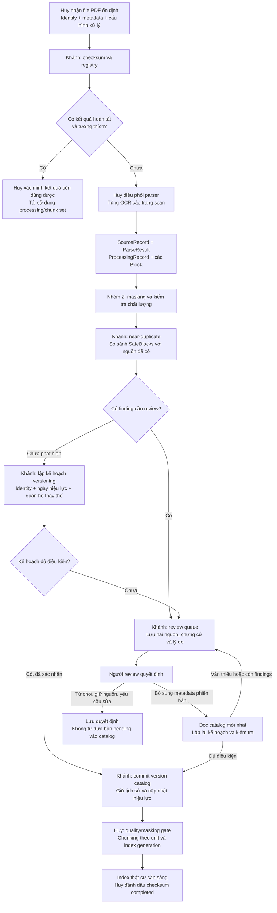

# Workflow phần việc của Khánh — Ingestion và data quality

Tài liệu mô tả phần code Khánh đã triển khai và cách bàn giao cho Huy tích hợp. Code được tổ chức theo chức năng trong `src/rag`, không còn package `w02`.

**Mục tiêu:** nhận biết file đã xử lý, phát hiện nguồn gần giống, quản lý phiên bản và hiệu lực, lưu các trường hợp cần người kiểm tra. Đầu ra giúp pipeline biết nội dung thuộc bản nào và được sử dụng tại thời điểm nào.

Các module và demo hiện chạy độc lập. Sơ đồ dưới là luồng tích hợp đề xuất; chưa có coordinator nối toàn bộ các bước vào `RAGPipeline`. OCR PDF scan do Tùng phụ trách, Huy tích hợp ingestion/chunking/index/retrieval, Nhóm 2 cung cấp masking và chuẩn hóa số liệu.

## 1. Sơ đồ tổng thể



Điểm cần phân biệt: **commit version catalog không có nghĩa index đã hoàn tất**. Near-duplicate chỉ tạo nghi vấn; việc chưa phát hiện gần trùng cũng không chứng minh dữ liệu đúng.

## 2. Những kiểu dữ liệu dùng chung

Schema là hợp đồng dữ liệu; không tự OCR, chia chunk hay quyết định hiệu lực.

| Đối tượng | Chứa gì? | Vai trò |
|---|---|---|
| `SourceRecord` | Nguồn/file, checksum, ngày thu thập | Truy lại nguồn đã nhận |
| `ProcessingRecord` | Parser/OCR/config, checksum nội dung, coverage | Biết nội dung được trích xuất bằng cách nào |
| `Block` | Text/bảng, thứ tự, vị trí nguồn, confidence nếu có | Đầu ra parser/OCR trước chunking |
| `SafeBlock` | Nội dung đã qua masking, vẫn giữ liên kết nguồn | Đầu vào so sánh và các bước sử dụng nội dung đã mask |
| `VersionRecord` | Tài liệu, phiên bản, ngày hiệu lực và quan hệ thay thế | Phân biệt các bản phát hành |
| `ContentUnit` | Đơn vị ổn định như Điều 3 | Xác định phần nào có thể được thay thế |
| `UnitRevision` | Nội dung cụ thể của một unit trong một phiên bản | Liên kết phiên bản với các block |
| `ApplicabilityRecord` | Khoảng hiệu lực và trạng thái duyệt của revision | Chọn nội dung theo ngày |
| `QualityIssue` | Vấn đề, hai nguồn/đối tượng liên quan, chứng cứ | Đầu vào review queue |
| `ReviewItem` / `ReviewDecision` | Hồ sơ chờ và quyết định có người xử lý, lý do | Lưu quá trình review |

Định danh quan trọng:

```text
document_id: tài liệu logic, giữ nguyên qua các phiên bản
version_id: từng phiên bản nội dung nguồn
processing_id: lần/cấu hình trích xuất nội dung
unit_id: đơn vị nội dung ổn định, ví dụ Điều 3
unit_revision_id: nội dung cụ thể của Điều 3 ở một phiên bản
```

Model nằm trong [models](../src/rag/models/__init__.py); schema RAG cũ trong `rag/schema.py` vẫn được giữ riêng, cần adapter khi tích hợp.

## 3. Checksum: tránh xử lý lại file giống hệt

Code: [checksum.py](../src/rag/ingest/checksum.py), [checksum_registry.py](../src/rag/ingest/checksum_registry.py).

**Đầu vào:** file nguồn ổn định, document identity nếu đã xác nhận, metadata phiên bản và cấu hình xử lý đầy đủ.

```text
Tính SHA-256 bytes của file
    → tra registry SQLite
    → đối chiếu identity + metadata + config + trạng thái hoàn tất
```

| Kết quả | Hành động của Huy |
|---|---|
| `reusable` | Xác minh generation/artifact còn hợp lệ, dùng lại kết quả đã xử lý |
| `new` | Chạy parse/OCR và các bước tiếp theo |

Đổi tên file không đổi checksum. Xuất lại PDF có thể đổi checksum dù chữ nhìn giống nhau; trường hợp đó cần đọc nội dung rồi so tiếp.

Không dùng lại kết quả xử lý dở/thất bại; identity chưa xác nhận hoặc config thay đổi cũng không được tự skip. `mark_completed` chỉ gọi sau khi index generation thật sự activate. Registry không thay thế version catalog hay cơ chế chống hai job ingest đồng thời.

## 4. Near-duplicate: tìm các nguồn gần giống

Code: [near_duplicate.py](../src/rag/ingest/near_duplicate.py).

**Đầu vào:** SafeBlocks của hai nguồn, cùng masking policy; hoặc gọi adapter `detect` với parser result, catalog và masker thực tế.

```text
Chuẩn hóa Unicode NFC, chữ hoa/thường và khoảng trắng
    → tách từ, số và dấu câu
    → SequenceMatcher so hai chuỗi token
    → tính similarity và trích phần khác biệt
```

Ví dụ hai bản dài gần giống nhau:

```diff
- Mức phí là 100.000 đồng/tháng.
+ Mức phí là 120.000 đồng/tháng.
```

**Đầu ra:** similarity, phân loại, hai nguồn, vị trí và diff trong `QualityIssue`. Caller có thể gọi `queue.enqueue(result.findings)` để lưu review. Detector không tự ghi database, xóa, gộp nguồn hoặc xác nhận quan hệ thay thế.

- Mặc định threshold vẫn là `0.85`. Policy v2 bổ sung score nội dung chính, metadata đã xác nhận và gợi ý priority để giảm review nhầm giữa các nguồn cùng mẫu. Chỉ khác document_id hoặc thiếu scope không đủ để loại cảnh báo. Xem [đánh giá baseline/v2 và giới hạn](NEAR_DUPLICATE_EVALUATION.md).
- Chuỗi token giống nhau sau masking chỉ là `same_content_candidate`, vẫn cần review.
- Số tiền, đơn vị và từ phủ định được giữ khi so sánh. Detector chưa làm quy đổi đơn vị hay xác minh mâu thuẫn số liệu.
- Nội dung bảng được so cả header, hàng/cột, đơn vị và ghi chú. Không so sánh pixel ảnh hoặc xác minh toàn bộ cấu trúc flowchart.

## 5. Versioning: xác định nội dung và hiệu lực

Code: [resolver.py](../src/rag/versioning/resolver.py), [articles.py](../src/rag/versioning/articles.py), [interfaces.py](../src/rag/versioning/interfaces.py).

**Đầu vào:** `ParseResult`, identity đã xác nhận, kết quả dedup, ngày hiệu lực và yêu cầu thay thế `ChangeRequest`.

**Đầu ra:** `VersionPlan`. Đây là kế hoạch, chưa ghi vào catalog:

| Action | Ý nghĩa |
|---|---|
| `create` | Tạo phiên bản/unit revisions và thay đổi hiệu lực được chỉ rõ |
| `link_existing` | Liên kết nguồn về phiên bản đã có sau các bước đối chiếu |
| `review` | Chưa đủ điều kiện; có lý do trong `review_reasons` |

### 5.1. Thay thế toàn bộ

```text
v1: phí 100.000 đồng, hiệu lực từ 01/01
v2: phí 120.000 đồng, thay v1 từ 01/07

Khoảng v1: [01/01, 01/07)
Khoảng v2: [01/07, chưa có mốc kết thúc)
```

Tại chính ngày 01/07, chọn v2. V1 vẫn được giữ để tra lịch sử. Không chọn bản hiện hành theo ngày upload.

Trước khi lập kế hoạch, [effectivity guard](EFFECTIVITY_GUARD.md) nhận diện nhiều mốc hiệu lực, ngày tương đối, điều kiện chuyển tiếp, đình chỉ, điều kiện theo sự kiện và ngày nguồn mâu thuẫn với metadata. Các trường hợp chưa hỗ trợ trả review dù caller đã điền một ngày. Repository và luồng xác nhận review cũng kiểm tra lại; chốt không tự tính hay diễn giải những điều kiện đó.

### 5.2. Sửa đổi một phần theo Điều

Ngay từ bản đầu, caller phân block thành các unit bằng `UnitAssignment`; có helper nhóm block theo heading Điều. Khi v2 sửa Điều 3:

```text
ChangeRequest:
    kind: partial
    effective_from: 01/07
    unit_mapping: revision cũ của Điều 3 → article:3
    unit_assignments: các block chứa toàn văn Điều 3 mới

Trước 01/07: Điều 1 v1 + Điều 2 v1 + Điều 3 v1
Từ 01/07:   Điều 1 v1 + Điều 2 v1 + Điều 3 v2
```

Chỉ khép hiệu lực Điều 3 cũ; Điều 1 và 2 giữ nguyên ID, nội dung và provenance. Bản v2 sửa một phần không làm toàn bộ v1 hết hiệu lực.

Caller phải xác nhận có toàn văn Điều sau sửa. Chốt [amendment guard](AMENDMENT_GUARD.md) chuyển review khi có chỉ dẫn sửa Khoản/Điểm, heading không khớp hoặc thiếu các Khoản/Điểm so với revision đích; `complete=True` không tự bỏ qua chốt. Repository kiểm tra lại trước khi ghi và review cũng phải đi qua chốt này. Đây là kiểm tra heuristic, không chứng minh đầy đủ nội dung khi OCR sai hoặc không có dấu hiệu nhận diện.

Code chưa tự diễn giải câu lệnh sửa từng từ/khoản. Catalog cũ chỉ có một unit toàn tài liệu phải được phân Điều qua migration được xác nhận; không tự tách ngầm. Những yêu cầu chèn lùi ngày hoặc vào giữa các bản tương lai đã lên lịch hiện trả review để tránh phá timeline.

## 6. Lưu catalog và chọn nội dung theo ngày

Code: [repository.py](../src/rag/versioning/repository.py), [scope.py](../src/rag/versioning/scope.py).

Khi plan đã được xác nhận, repository ghi nguồn, processing, blocks, version, unit revisions và thay đổi hiệu lực vào SQLite trong một transaction.

- Giữ lịch sử và audit thay đổi hiệu lực.
- Nếu catalog thay đổi sau khi lập kế hoạch, báo `ConcurrentUpdateError` để đọc lại và lập kế hoạch mới.
- Lặp đúng plan/request đã commit không tạo thêm phiên bản.
- Lỗi giữa chừng làm rollback cả phiên bản và timeline.

`UnitScopeResolver.resolve_units` nhận `QueryScope` và snapshot catalog:

| Mode | Nội dung chọn |
|---|---|
| `current` | Unit revisions có hiệu lực tại ngày hiện tại theo timezone cấu hình |
| `as_of` | Unit revisions có hiệu lực tại ngày được chỉ định |
| `all_versions` | Lịch sử đã duyệt |

**Đầu ra:** `UnitSelection`, gồm unit, revision, applicability và các blocks nguồn. Unit mơ hồ không được chọn tùy ý; kết quả có `ambiguous_unit_ids`.

Đây là lựa chọn ở cấp nội dung, chưa phải các chunk đã qua quality gate/index activation. Khi Huy tích hợp retrieval, vẫn cần lọc cả BM25, vector, merge và context theo phạm vi hợp lệ; không tìm global top-k rồi chỉ loại bản cũ ở cuối.

## 7. Review queue: hồ sơ chờ người kiểm tra

Code: [review_queue.py](../src/rag/quality/review_queue.py).

Ví dụ v2 có nội dung mới nhưng thiếu ngày hiệu lực:

```text
Planner trả review
    → enqueue_version lưu input pending và lý do
    → list_items/get để xem hồ sơ
    → reviewer bổ sung ngày và quan hệ thay thế
    → resolve kiểm tra queue revision
    → đọc catalog mới nhất và lập kế hoạch lại
    → đủ điều kiện: lưu quyết định + cập nhật catalog trong cùng transaction
    → chưa đủ: giữ open và báo ReviewBlockedError
```

Quyết định hỗ trợ: `accept`, `confirm_replacement`, `link_existing`, `reject`, `keep_both`, `request_correction`. Có lưu người xử lý, lý do và thời điểm.

Các nguyên tắc:

- Chạy lại cùng finding không tạo hồ sơ trùng; issue đã xử lý không tự mở lại.
- Hai reviewer không được ghi đè quyết định của nhau; retry đúng decision ID/payload là idempotent.
- `resolved` chỉ nghĩa là hồ sơ đã xử lý, không đồng nghĩa phiên bản được chấp nhận.
- `keep_both` ghi quyết định giữ nguồn, không tự approve dữ liệu pending hay chọn một nguồn đúng.
- Xác nhận metadata phiên bản không tự xóa findings OCR/PII/dedup. Nếu còn blocker, cần sửa input hoặc bổ sung policy xử lý phù hợp.
- Input pending nằm ở bảng nội bộ, chưa có trong catalog phục vụ truy vấn. API danh sách/chi tiết chỉ trả metadata và evidence an toàn do caller cung cấp.
- Hiện thao tác qua API Python; chưa có UI hay xác thực reviewer.

## 8. Khánh bàn giao gì cho Huy?

| Khánh cung cấp | Huy tích hợp |
|---|---|
| Models và interface theo chức năng | Adapter parser/OCR về schema chung |
| ChecksumRegistry | Gọi trước parsing; đánh dấu completed sau index activation |
| NearDuplicateDetector và findings | Cấp masker, snapshot và đưa findings vào review |
| VersionPlan và VersionRepository | Nối vào ingestion theo quality/approval policy |
| Unit revisions, block IDs và provenance | Chunking giữ đúng unit/version, không trộn nội dung |
| UnitScopeResolver | Giới hạn dữ liệu hợp lệ cho mọi retrieval arm/context |
| Review queue | Luồng thao tác người dùng và xử lý lại sau quyết định |

Đầu vào chunking gồm **blocks đã xử lý/mask + liên kết unit/version + assessment chất lượng + cấu hình chia chunk**. Versioning không tạo text mới; nó xác định blocks thuộc phiên bản/unit nào. Chunker của pipeline dùng text từ blocks và mang theo các liên kết đó để tạo chunks.

## 9. Các demo để trình bày

Chạy tại `app/team-4.2`:

```powershell
# Thay toàn bộ và tra cứu lịch sử
.\.venv\Scripts\python.exe -X utf8 -m scripts.demo_versioning

# Chỉ thay Điều 3, giữ Điều 1 và 2
.\.venv\Scripts\python.exe -X utf8 -m scripts.demo_partial_versioning

# Thiếu ngày hiệu lực → review → bổ sung → áp dụng phiên bản
.\.venv\Scripts\python.exe -X utf8 -m scripts.demo_review_queue

# Hai nguồn gần giống, khác số tiền → một hồ sơ review
.\.venv\Scripts\python.exe -X utf8 -m scripts.demo_near_duplicate
```

Demo dùng dữ liệu giả lập, mặc định lưu trong thư mục tạm. Các script hỗ trợ `--database <đường-dẫn-riêng>` để giữ dữ liệu. Không có OCR thật hay LLM trong các demo này.

## 10. Công nghệ và phần việc còn lại

| Thành phần | Công nghệ |
|---|---|
| Schema và contracts | Python dataclass, type hints, Protocol |
| Fingerprint | SHA-256 qua hashlib, canonical JSON |
| Lưu catalog/queue | SQLite, transaction, revision và audit |
| Near-duplicate | Unicode NFC, tokenization, difflib.SequenceMatcher |
| Thời gian và số liệu trong schema | date/datetime có timezone; Decimal serialize thành chuỗi |
| Kiểm thử | pytest, fixture giả lập, database tạm, demo restart |

conflict detection cho số liệu có cấu trúc, phối hợp API chuẩn hóa số của Nhóm 2, đánh giá trên fixtures có nhãn và hỗ trợ Huy tích hợp. Các tests chức năng hiện có chưa thay thế báo cáo TP/FN/FP của tuần 2. Chưa có luồng end-to-end PDF thật → OCR → quality/versioning → chunk/index → trả lời được nối bởi phần code này.
